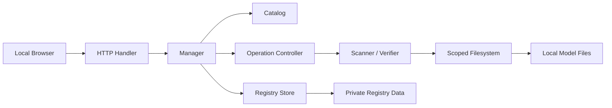
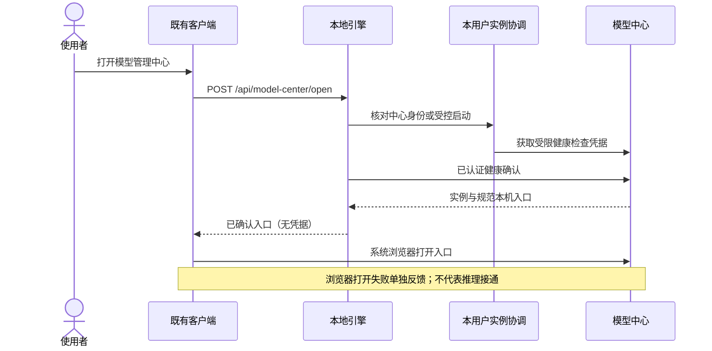
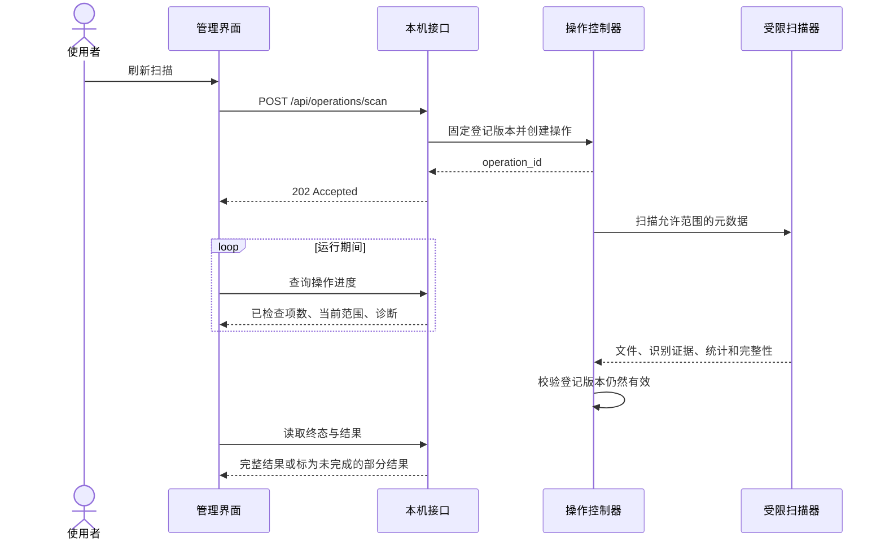

# Design Document

> 用户已明确“执行所有任务”，本版 Requirement 1–14 与增量设计进入批量实施和验证阶段。中心不执行模型推理、不启停推理服务、不写回消费者模型配置；组件缺少构建输入或未执行真实验收时如实保留未交付、未验证状态。

## Overview

本设计落实已确认的本地模型中心需求，采用独立 Go 模块、内嵌静态中文 Web 界面和仅回环 HTTP 服务。首期以资产及交付组件盘点为边界：识别模型文件线索、登记路径、统计逻辑大小、查看依赖和按需计算 SHA-256。新增显式开发构建与组件清单流程，运行时不依赖宿主机 Python 或编译器；中心自身不运行推理、不管理消费者秘密、不自动修改既有三端模型配置。

三端集成限于现有区域内隐藏自定义 URL 模型接入、打开中心和只读依赖检查。二进制打包只建立可交付组件，不在本期替换现有音色消费者的执行链；没有构建或验证的组件如实标为待构建或未验证。旧任务快照继续按旧语义执行，新建任务不得借隐藏功能继续新启用自定义接入。

技术选择：

- 保持 `src/model_center` 的独立 Go module，最低 Go 1.25；优先验证 Windows，平台文件操作隔离在少量适配文件中。
- 使用 Go 标准库承载 HTTP、JSON、目录受限访问、散列及内嵌资源。Windows 文件身份、登记锁和安全替换使用系统 API 的薄封装，不增加 Python、Node 或第三方模型运行时依赖。
- 界面使用本地 HTML、CSS、JavaScript，不引入前端构建链、远程资源、框架或 CDN。浏览器自动化仅为开发期测试工具，不是运行依赖。
- 扫描和摘要计算作为进程内可取消操作执行，HTTP 请求只负责启动、查询、取消和读取结果。文件结果分页返回，避免把最多十万项文件一次发送给浏览器。
- 资产证据只持久化路径登记；扫描结果、文件 ID、摘要和任务记录保留在本次进程内，重启后重新盘点。组件 manifest 属于只读构建产物，不由扫描改写。
- 同一 Go module 提供公开的轻量 `integration` 包，供三端本地引擎通过本地 module replace 使用，统一中心定位、实例身份确认、启动与只读状态协议；不拉入中心 UI、扫描器或模型运行库。
- 新增实例发现描述文件与 Windows 命名管道，仅用于本用户中心进程发现与短期握手，不存浏览器会话 token、不存模型或消费者秘密；退出后按实例 ID 清理自身描述。

### Existing Baseline and Required Corrections

现有初稿中的模型目录、独立启动参数和回环服务方向可以保留，但以下行为必须在实施时替换，不作为已完成能力：

| 初稿位置 | 当前行为 | 设计要求 |
|---|---|---|
| `catalog.go` | 十二项元数据和文件名模式 | 补依赖、组成规则、识别证据及每类允许扩展名 |
| `manager.go` | 按 basename 去重 | 保留全部不同文件，以文件身份统计别名，以摘要证明内容相同 |
| `manager.go` | 登记目录内所有权重归属同一模型 | 匹配项与身份未确认项分开，不靠登记确认型号 |
| `manager.go` | `Stat` 跟随链接，直接按路径打开 | 受限根、无目录链接递归、句柄身份与打开后范围复核 |
| `manager.go` | 取消丢弃整个结果 | 保留有界部分结果并标记不完整，不覆盖上次完整结果 |
| `manager.go` | 进程内 mutex 和普通 Rename | 数据目录单写锁、revision 冲突检查、平台安全替换 |
| `main.go` | 同步扫描和校验 | 后台操作与明确取消接口，查询不触发磁盘扫描 |
| `web` | 尚无内嵌界面资源 | 补中文可访问界面及实际操作，不宣称当前可构建或可用 |

实施阶段按任务替换上述初稿；以实际代码和测试结果认定完成，不以设计描述代替交付。

## Architecture

### Process Boundary



图中盘点组件均在同一 Go 进程内；模型文件只读，持久化仅涉及独立数据目录及实例发现描述。中心独立运行不依赖三端、Billing、Generation、Ollama 或 Python 服务。三端本地 Go 引擎通过 `integration` 包与中心的本用户 IPC 和回环只读 API 集成；中心不反向调用三端或远端服务。开发构建器与中心运行进程分离，不在扫描中启动。



### Scan Sequence



登记或取消登记成功后，旧登记版本的活动操作被取消，旧结果标为过期；不会由旧操作迟到完成而覆盖新配置下的结果。

### Limits and Lifecycle

| 项目 | 首期默认值与行为 |
|---|---|
| 活动文件操作 | 全局最多一个扫描、权重 SHA-256 或组件清单校验操作，避免磁盘争用；重复发起返回 409 |
| 扫描项数 | 所有范围累计最多 100000 个目录项，含运行环境目录；重复范围不重复遍历 |
| 扫描时限 | 10 分钟，达到上限返回不完整结果与具体诊断 |
| 目录深度 | 最多 64 层，达到上限跳过该子树并标记不完整 |
| 摘要时限与内存 | 单次最多 30 分钟，顺序读取，每次 1 MiB 缓冲；不并行读取全部大文件 |
| 文件列表 | 默认每页 200 条，最多 1000 条；绑定不可变结果版本的分页游标 |
| 操作记录 | 最多保留 32 个终态操作，终态 30 分钟后可回收；当前及上次完整盘点结果不因普通操作回收而消失 |
| 请求体 | 最大 8192 字节；拒绝未知字段、多 JSON 值和不合法类型 |
| 查询频率 | 界面运行时约每秒查询，终态停止；不创建持续自动扫描 |
| 退出 | 先标记服务关闭、拒绝新 API 操作，再取消活动操作、关闭连接和根句柄，最后释放登记锁 |

取消在目录枚举批次和摘要每次读取间检查；阻塞的操作系统 I/O 可能不能立即中断。取消后禁止发布成功结论，不能承诺任意损坏磁盘上的硬实时退出；进程终止由操作系统释放锁。

## Components and Interfaces

### 1. Startup and HTTP Host

继续提供 `-root`、`-data` 和 `-listen`，独立启动默认监听 `127.0.0.1:18120`；客户端首次显式启动同样使用该端口，已确认的独立实例可以使用其他回环端口。端口被非可信进程占用时报错，不自动换端口或访问占用者。不自动打开浏览器、不自动联系更新服务，只有用户点击客户端入口才触发打开。

- 开发项目根必须存在且包含 `src/generation_server` 和 `sidecar` 目录；缺省从当前目录逐级向上检查同样特征。安装布局使用构建时生成且与引擎预期摘要绑定的资源布局清单验证，只允许布局内声明的模型、组件及 Haar 数据相对位置，不把任意存在的目录当有效根。开发/安装布局为显式不同的根类型，不以缺少源码目录自动放宽验证。
- `-data` 缺省为用户配置目录下的 `FengshenSlicer/model-center`；首次启动创建本用户私有目录。若无法获得必要权限或排他锁，启动失败并给出中文原因，不降低权限继续写入。
- `-listen` 仅接受字面量回环 IP 和端口，支持 IPv4/IPv6；不把 DNS 名称解析结果当作监听授权。
- 以实际 listener 地址生成唯一 Host 和 Origin；不信任 Forwarded/X-Forwarded-*。浏览器使用启动日志提供的规范入口，其他 Host 被拒绝。
- Windows 是主验收平台；非 Windows 适配使用对应文件锁与同目录替换语义。未知或未验证的平台在启动时明确拒绝需要的文件安全能力，不悄悄退化为无锁写入。

### 2. Catalog

目录保持十二项稳定 ID，新增以下字段：`dependencies`、`components`、`allowed_extensions`、`recognition_rules`、`consumer` 和 `identity_note`。可选性表示对应功能可选，不表示启用该功能后可以缺少必需依赖。

| ID | 识别规则与组成 | 调用与身份边界 |
|---|---|---|
| whisper-asr | 登记 `.bin/.ggml/.gguf` 候选，不凭扩展名确认架构或型号 | Go → whisper.cpp；仅表示用户提供转写模型文件 |
| whisper-vad | 登记 `.bin/.ggml/.onnx` 候选 | Go → whisper.cpp；不冒充固定 VAD 型号或已确认兼容 |
| local-text | 登记 `.gguf/.safetensors/.bin` 候选 | Go → 本地 HTTP 服务；未登记时磁盘大小未知 |
| local-vision | 同本地文本模型，配套 projector 等文件仍逐项展示 | Go → 本地 HTTP 服务；不凭文件名确认多模态能力 |
| demucs | `955717e8-*.th`，一项组件 | Go → Python/PyTorch |
| demucs-ft | `f7e0c4bc-*`、`d12395a8-*`、`92cfc3b6-*`、`04573f0d-*` 的 `.th` 文件 | 同一组成组四项均非空才组成齐全 |
| seed-vc | 精确 DiT 权重文件名；依赖 seed-whisper/campplus/bigvgan | Go → Python/PyTorch，非 F0 分支 |
| seed-whisper | Whisper Small 仓库身份 + `model.safetensors` | Python → Transformers/PyTorch；区别高光转写 |
| campplus | `campplus_cn_common.bin` | Python → PyTorch |
| bigvgan | 指定 BigVGAN 仓库身份 + `bigvgan_generator.pt` | Python → PyTorch |
| haar-frontal | 明确项目位置或精确文件名的 `.xml` | Go 直接读取；源文件存在不代表已经核验安装程序内嵌版本 |
| haar-profile | 明确项目位置或精确文件名的 `.xml` | Go 直接读取，同上 |

匹配文件名只产生 `recognized_by_rule` 证据，不是权重内容认证。外置 Whisper Small/BigVGAN 目录失去仓库身份时显示候选，不为方便而放宽规则。手动登记未知模型不读取权重 header 以猜测量化与参数规模。

复合模型的 `components` 按同一目录或同一 Hugging Face snapshot revision 分组，不跨不相关目录拼成一套完整权重。不同组分别展示；只有依赖文件被发现时才能显示“依赖文件已发现”，不推断兼容或推理成功。

首期不展示云模型列表，避免混淆本地资产边界；在说明区注明远程模型权重不由此中心盘点。能量 VAD、参考声音和运行环境不加入十二项模型计数。

### 3. Registry Store

登记表按模型 ID 保存一处显式路径；无登记时使用默认发现规则，有登记时该模型仅使用登记范围。登记失效时保留原登记并报错，不静默使用默认发现替代。

建议接口：

```go
type RegistryStore interface {
    Snapshot() RegistrySnapshot
    Update(ctx context.Context, expectedRevision uint64, modelID, path string) (RegistrySnapshot, error)
    Close() error
}
```

#### Validation

- 路径来自本机界面的明确输入；只在登记接口接受路径，校验、详情和文件接口不接受任意路径。
- 必须为本机绝对普通文件或目录；拒绝卷根、UNC、设备命名空间、替代数据流和非普通文件。Windows 远程映射盘不作为本机盘点范围。
- 目录登记只授权该目录树；单文件登记只授权该文件，不顺带授权父目录其他文件。
- 用户显式登记的入口如果是链接，解析后展示和保存目标路径、原输入及句柄身份；后续入口指向其他目标时要求重新登记，不默许授权变化。
- 文件扩展名按目录项校验；目录内不匹配的权重显示候选，不纳入该模型已识别权重总量。
- 取消登记通过显式 DELETE 实现，不依赖空字符串的隐藏语义。

#### Concurrency and Durable Save

1. 启动时先对独立 `registry.lock` 文件取得进程生命周期排他锁，再读取登记表；第二个使用同一数据目录的中心启动失败。锁文件不在解锁时删除，避免换 inode 形成双锁。
2. 首次缺少登记表表示未登记；非空文件必须严格解析 schema、revision、已知模型 ID 和字段，不把损坏内容当空表。
3. 更新要求 `expected_revision`，事务内互斥；过期返回 `registry_conflict`。界面重新读取后由用户确认重试，不盲目覆盖另一个窗口的修改。
4. 提交前重读磁盘版本及内容指纹，若被外部程序修改则进入错误态，禁止覆盖未知内容。
5. 同目录独占创建临时文件，完整写入、Sync、检查 Close 后再执行平台替换。Windows 已有目标采用 ReplaceFileW 并保留上一份备份，首次写入采用受控移动；非 Windows 使用已验证的同目录原子替换。
6. 只有提交状态被确认后才更新内存 revision。平台替换报告异常时检查目标、临时文件和备份；如果结果不确定，冻结后续写入并报告持久化状态不确定，不宣称保存失败后仍可安全重试。
7. 上一有效内容或备份不被清理操作破坏；首期不实现“重置损坏登记表”。损坏时界面提供只读目录与错误提示，由使用者明确修复本机数据后重启。

Windows 私有目录使用用户 SID 限制 DACL，不能以 `0700` 在 Windows 上等价实现权限隔离。进程锁和 ACL 防误写及其他用户读取，不承诺抵御同一用户权限下的恶意本机程序。安全替换防半写内容，不承诺所有文件系统上的断电绝对持久；主平台须做真实文件系统故障与共享冲突测试。

兼容当前初稿已保存的纯 `model_id → path` JSON：严格识别该唯一旧格式为 revision 0，保留原文件；首次成功更新时按上述事务迁移到版本化格式。混合格式和未知字段视为损坏，不猜测恢复。

### 4. Scope Resolver and File Access

默认资产范围：

- 项目 `sidecar/seed-vc/checkpoints`。
- 项目 `models`。
- 用户主目录 `.cache/torch/hub/checkpoints`。
- 两个 Haar XML 的明确项目位置，仅访问这两个文件，不扫描其父级树。
- 每个目录项当前有效登记的文件或目录，只用于该目录项识别。

运行环境独立范围：项目 `sidecar/venv` 作为历史开发环境统计，只发现解释器文件，不视作交付组件；受控组件目录作为交付运行环境另行统计，不能把两者简单相加到权重总量。Whisper CLI 优先按受控 manifest 发现，未交付时显示“组件待构建/未发现”，不读消费者配置、不搜索 PATH 或整盘。HTTP 模型固定显示“当前版本接入入口已隐藏；模型服务未检测”，仍保留权重盘点和历史调用关系。

受限访问流程：

1. 项目和登记目录用 Go 1.25 的 `os.OpenRoot` 保持根句柄，项目下默认子根从项目 Root 相对打开；根被重命名不自动转向同名新目录。
2. 打开授权入口时确认普通目录/文件、最终位置和可用身份；登记指向单文件时内部可持有父根句柄，但访问策略只允许精确叶文件及其固定身份。
3. 批量读取目录项，使用 Lstat 类信息分类；`.git`、`.hg`、`.svn`、`.locks` 子树跳过。目录 symlink、junction 及其他可跳转 reparse point 不入栈。
4. Windows 适配用无跟随句柄检查 reparse tag，并对实际打开句柄复核最终位置、卷与文件 ID。不能只做字符串前缀、EvalSymlinks 或“先 Lstat 后普通 Open”。
5. 文件链接只有在同一授权范围内可安全解析为普通文件时计入，保留链接来源与目标关系。Root 拒绝的绝对链接、跨范围链接和未知 reparse 类型明确列为未计入，不降级普通路径打开；多个允许根也不组成可相互跳转的超级根。
6. 所有路径包含性按组件判断，覆盖大小写、分隔符、卷和 Windows 特殊路径。文件句柄身份优先于路径展示名；边界不能确认时停止该项访问。

`os.Root` 不是完整沙箱，不能阻止所有硬链接或平台挂载关系；已存在于授权根内的硬链接按该文件处理并展示别名。中心不创建链接，也不通过链接遍历授权外文件。仅承诺支持平台上经测试的范围约束，不承诺对操作系统管理员的隔离。

### 5. Scanner and Recognition

建议核心方法：

```go
func (m *Manager) StartScan(ctx context.Context, revision uint64) (Operation, error)
func (m *Manager) StartVerify(ctx context.Context, inventoryID, modelID string, fileIDs []string) (Operation, error)
func (m *Manager) Cancel(operationID string) (Operation, error)
```

请求中的 `ctx` 用于接收启动请求；后台操作从服务生命周期 context 派生，不随启动 HTTP 请求结束而立即取消。取消通过专用接口，服务关闭和登记版本变化也会触发取消。

扫描开始冻结登记 revision、目录规则版本和各授权范围；每个不同根只枚举一次，保持范围与模型绑定。部分重叠目录按统一文件身份索引去重，外置登记内容不会因重叠被自动归属给其他模型。

普通扫描只获取元数据。Hugging Face snapshot 的已知文件名结合仓库路径用于规则识别；blobs 目录中无扩展名对象归为缓存对象线索，不因为名字像摘要就认定内容已经校验。可安全解析的 snapshot 文件链接建立与 blob 的关系；普通文件副本只有按需摘要相同后才升级为内容相同证据。

扫描错误按范围、目录或文件隔离，继续访问安全的兄弟目录。缺失的默认缓存目录是 `missing` 而不是失败；已登记路径缺失、权限不足及达到限额会使相应范围不完整。所有输出按目录项顺序和规范路径稳定排序，不由文件系统枚举顺序决定。

### 6. Accounting and Evidence

以三个彼此独立的量展示空间：

1. **已识别权重逻辑大小**：全部符合识别规则的不同文件对象大小之和。不同普通文件副本即使摘要相同也分别占一份，不按 basename 或 hash 减除。
2. **资产扫描范围逻辑大小**：模型/缓存范围内全部普通文件对象大小之和，包含尚未确认身份的缓存对象和辅助文件。
3. **运行环境逻辑大小**：运行环境范围内文件对象大小之和，与模型权重分栏，不当作模型权重。

相同路径与可确认的硬链接/文件链接目标只计一次，保留路径数量。Windows 使用卷标识与文件 ID，支持的其他平台使用设备与 inode；不可用时仅去重可确认路径，并把 `identity_quality` 标为有限，不宣称跨路径物理去重。

范围间有重叠时，各栏可分别显示包含关系，但不提供简单相加的“总空间”。若展示所有范围合计，必须对三个范围集合求文件对象并集。每模型数字仅含自身文件，不隐式加上依赖；Seed-VC 套件汇总单独展示且按依赖文件并集计算。

同名或同大小只生成 `duplicate_candidate`；有当前有效摘要且摘要和长度相同才生成 `content_equal`。两者均不产生可安全删除结论。“单套必要权重大小”在多版本和身份不明时显示未知，不从最小文件或第一条路径猜测。

容量 API 使用十进制字节字符串，防 JavaScript Number 大整数精度损失；界面用 BigInt 做 1024 进制换算。`bytes = null` 表示未知，`bytes = "0"` 且状态完整才表示测得零；部分扫描数字明确标为“已扫描部分”，不是完整容量。

### 7. Verifier

- 请求只能提交某次盘点中该模型可见的 opaque 文件 ID；可选全部由界面展开成该模型当前候选/已识别文件集合，服务端再次校验归属，限制最多 1000 个 ID。
- 不接受新路径、预期摘要下载地址或 shell 参数。首期不提供官方摘要导入；所有成功结果固定为 `fingerprint_computed`，不会生成发行方匹配或推理通过状态。
- 开始前验证 inventory、登记 revision、根身份、文件 ID 和元数据仍有效；每个文件通过受限范围重新打开，比较扫描时身份，再进行 1 MiB 顺序读取。
- 结束时比较句柄前后身份、大小、mtime、实际读取字节数，并复查路径是否仍指向同一对象。任意可检测变化都使该文件摘要无效；只读失败不使其他文件的已完成摘要失效。
- 校验结果绑定文件身份与扫描证据。后续扫描删除、替换文件或观察到大小/时间变化时标为 stale；登记 revision 变化使其过期，重启直接丢弃。
- 同大小、同 mtime 的恶意原位修改不能仅凭元数据完全检测；结果措辞为“本次读取字节的 SHA-256”，不声称读取了原子文件快照。读取失败、变更、取消的文件均不发布有效摘要。

### 8. HTTP API

浏览器管理 `/api/` 路由要求会话头 `X-Model-Center-Token`，不启用 CORS；仅 `/api/integration/health` 和 `/api/integration/dependencies` 使用经过 IPC 身份确认发放的短期只读凭据，两类凭据不可互换。以下是新模块内部协议，不需要保持初稿尚未交付的同步 API 兼容。

| 方法 | 路径 | 请求与结果 |
|---|---|---|
| GET | `/api/state` | 目录、登记 revision、存储错误状态、当前/上次完整 inventory 引用、活动操作及能力说明；不扫描 |
| GET | `/api/inventories/{id}` | 盘点概览、十二项状态、范围和统计，不返回全部文件 |
| GET | `/api/inventories/{id}/models/{model_id}/files` | 当前模型文件分页；cursor 与 limit 经过验证 |
| POST | `/api/operations/scan` | `{registry_revision}` → 202 和 operation |
| POST | `/api/operations/verify` | `{inventory_id, model_id, file_ids}` → 202 和 operation |
| GET | `/api/components` | 受控 manifest 的组件与正交证据摘要；不加载库、不执行组件 |
| POST | `/api/operations/verify-component` | `{component_id, version}` → 202；仅校验受控清单文件，复用全局单操作 |
| GET | `/api/integration/health` | 受限只读凭据；返回中心身份、协议、构建及 UI 资源状态 |
| GET | `/api/integration/dependencies` | 受限只读凭据；返回无路径/无秘密的已有盘点与组件证据投影，不扫描 |
| GET | `/api/operations/{id}` | 进度、终态、结果引用、摘要结果与分类诊断 |
| POST | `/api/operations/{id}/cancel` | 幂等取消；已终止则返回当前终态，不重启操作 |
| PUT | `/api/registrations/{model_id}` | `{path, expected_revision}` → 新登记 revision |
| DELETE | `/api/registrations/{model_id}` | `{expected_revision}` → 新 revision，恢复默认发现 |

界面取消登记后明确发起新扫描，而不是把旧结果重新标为当前。所有成功修改响应包含 revision，界面不靠本地乐观状态声称已保存。

同模型文件结果可以分页校验；单次超过 1000 个文件时界面提示分批，不静默截断。未知资源 404、已回收结果 410、合法路由错误方法 405 并带 Allow、冲突 409、请求超大 413、语义输入错误 422。API 不将底层完整错误堆栈直接回传。

### 9. Local Web UI

同一界面工作区包含：

- **顶部**：本地模型中心标题、项目根、刷新按钮、活动操作及取消入口。
- **概览**：十二项目录项状态、已识别权重逻辑大小、资产范围逻辑大小、运行环境逻辑大小；部分或未知值必须同时显示文字。
- **列表**：搜索、类别/运行环境/状态筛选；模型名称、用途、调用链、文件状态、大小和详情入口。
- **详情**：识别证据、依赖与组成组、登记路径表单、文件分页、路径展开/复制、SHA-256 结果及免责声明。
- **交付组件区**：原生/冻结打包方式、平台、入口、运行库及权重引用；分开显示待构建、文件状态、按清单校验、入口测试与协议声明。只提供已接通的组件摘要校验，不提供运行推理/构建/安装按钮；未验证项不显示就绪。
- **底部说明**：登记不写回客户端；不下载、不清理、不推理；磁盘大小不是 RAM/VRAM。

UI 状态保留 `lastCompleteInventory`、`lastAttempt` 和 `registrationRevision`，分别表示上次完整数据、最近扫描/错误和当前登记。失败时保留有效视图；旧数据与取消的部分数据用明确标签区分。没有 inventory 时仍展示十二项静态目录与“尚未扫描”。

视觉系统先在本地 CSS 定义语义色、字号、间距、边框、圆角、阴影与焦点 token。使用克制的浅色工作台、单一主色、系统中文字体和可访问状态标签；无图片业务需求，不引入生成图或装饰性外部图片。宽屏采用列表加详情布局，低于 900px 改为单列，360px 下核心按钮与表单仍可操作；长路径使用等宽文本、折行与复制按钮。

搜索匹配名称、家族、用途，筛选在目录级本地完成，条件按 AND 合并；清空入口同时重置条件。请求期间只禁用冲突操作，保留搜索与详情。错误使用 `role=alert`，非致命进度用 `aria-live=polite`；使用原生 button、label、dialog，弹窗管理焦点、Esc 和返回焦点，支持 reduced-motion。

所有文件名、路径、诊断使用 textContent 或文本节点，禁止动态 innerHTML。剪贴板写入失败时保留可选中文本，不假报复制成功。取消确认不需要破坏性警告，因为它不改权重；取消登记提示“仅取消中心登记，不删除文件”。

### 10. Binary Component Admission and Explicit Build

组件交付与模型文件识别使用两套正交证据。新目录建议为 `src/model_center/build`（构建输入与清单生成代码），开发输出放仓外指定目录，安装资源布局固定为引擎旁 `model-center/fengshen-model-center.exe` 与 `model-center/components/{component_id}/{version}`。不搜索 PATH，不接受运行时表单指定组件执行路径。具体构建输入的依赖版本、上游提交、许可证及工具版本必须锁定，不从当前可变 venv 直接生成“可信清单”。跨端共用的构建调用脚本放 `installer` 根，复用同一构建流程；本规格只做本地产物，不执行三端发布。

| 组件 ID | 交付方式 | 对应资产与边界 |
|---|---|---|
| model-center | Go 构建的 EXE 和内嵌 Web | 中心自身，不依赖 Python/Node；嵌入协议与规则/布局 schema 摘要，最终 EXE 摘要由外部交付清单记录 |
| whisper-batch | 固定版本 whisper.cpp 原生 CLI 与必需 DLL | 高光转写及可选 VAD，批处理能力不推出流式能力 |
| whisper-stream | 支持指定协议的原生 CLI 与 DLL | 必须有 `--fengshen-stream-v1` 和 `fengshen.whispercpp.stream/v1` 声明；当前只有 Go 调用端证据，缺少实现/构建输入时列为未交付，不制造占位 EXE |
| demucs-runner | PyInstaller onedir 冻结入口与私有运行时 | htdemucs/htdemucs_ft；保留既有参数与 WAV 产物契约 |
| seedvc-runner | PyInstaller onedir 冻结入口与私有运行时 | Seed-VC 与三项配套权重；保留当前非 F0 分支 |
| haar-consumer | 现有 Go 消费者构建证据 | XML 是数据，不另编译 C++；发现 XML 不证明某个运行中消费者的内嵌内容 |

PyInstaller 是构建阶段工具，不是产品运行依赖；选择 onedir 是为了明确携带解释器、PyTorch/CUDA DLL、原生扩展及配置，不承诺单 EXE。构建失败不能退回“源码加 venv 即已交付”。PyTorch、cuDNN 等使用匹配版本的预编译文件，不重新编译，也不改为 Go 任意调用 DLL。GPU 驱动列为外部要求，不把 CUDA Toolkit 当终端用户必要依赖；当前 Seed-VC 的 BigVGAN 保持 `use_cuda_kernel=False`，禁止首启编译扩展。

现有两个 wrapper 都通过 `sys.executable` 启动 Python 子进程，不能直接冻结后原样使用：冻结后的 `sys.executable` 指向 runner EXE。构建任务须为冻结入口增加受控子命令分发，将 Demucs 模块和 Seed-VC `main(args)` 纳入打包入口；不得拼接 shell 或从表单传入模块/脚本名。允许保留当前开发脚本方式，但二进制交付入口不得依赖旁置裸 `.py`、系统 Python 或宿主 venv。运行时资源按冻结布局解析，保留参数、输出命名和退出码；本期不把既有 Go 音色调用者自动切换到新 runner。

显式构建命令依次完成：校验锁定输入 → 编译/冻结 → 收集必需依赖和许可证 → 拒绝绝对路径/越界文件 → 逐文件大小与 SHA-256 → 生成 manifest 与资源布局清单 → 生成受控启动测试报告。中心构建只嵌入协议、模型规则及布局 schema 摘要，不嵌入包含自身 EXE 摘要的最终 manifest；先构建中心，再生成含中心摘要的外部交付清单，最后将该清单及中心 EXE 预期摘要注入三端引擎。组件 manifest 不含自身或启动报告文件的摘要；启动报告引用 manifest 摘要，由最终交付清单同时绑定两者，避免摘要循环。首次开发试用显式完成“构建中心与可获得组件 → 生成交付清单/报告 → 构建本地引擎并固定预期摘要”，不靠已有中心进程完成自举。构建时允许维护者事先准备编译器和打包工具，但不自动下载模型，不从普通中心 API 暴露构建接口。缺少 Whisper 流式源码或其他构建输入时，报告具体缺口，其余组件可独立构建，不伪造该组件成功。

manifest 有 schema、component_id、version、os、arch、entry_type、entry、packaging、protocols、files、runtime_dependencies、model_refs、driver_requirements、build_inputs 和验证报告引用。文件相对路径严格局限组件根，禁止绝对路径、`..`、设备路径、ADS 与跨根链接；重复 ID/版本/路径和依赖环报错。DLL 仅盘点，不由中心 `LoadLibrary`。本地生成的清单/摘要证明一致性，不自动声称官方认证或供应链可信。

组件状态拆为 packaging、platform、files、integrity、startup_test、protocol_evidence、inference。元数据扫描只确认文件存在、非空、大小及平台；`integrity=not_checked` 为默认值。显式组件校验复用全局单操作和受限流式 SHA-256，逐文件对比 manifest，不在每次依赖检查读全部 DLL。摘要不符或文件观测变化使既有结论失效。首次入口启动测试由开发构建流程执行 `--component-info`，不加载模型、不联网；将无系统 Python/编译器、无开发目录挂载的干净测试环境及构建摘要记录为证据，普通修改 PATH 不能冒充干净环境测试。协议声明与运行验证分别展示，所有测试都不升级 inference。

### 11. Current-release URL Feature Policy and Snapshot Preservation

这是当前版本固定产品边界，不新增用户开关或远程 feature flag。共享策略定义 `custom_url_model_configurable=false`、`center_inference_available=false`，由各引擎的只读能力响应提供给现有页面；旧任务执行器不使用它重写快照。

| 端与位置 | 隐藏或限制 | 保留 |
|---|---|---|
| 用户版传统工作区高光配置卡 | 本地 HTTP 执行选项、URL/型号/超时/Key 接入区、独立本地视觉开关与其关联字段、测试/保存入口 | 已支持的云端公开配置只读投影及授权；本地历史配置只给“本版本暂停接入”说明和中心入口，不自动切到云端 |
| 开发版 AI 配置页高光卡 | 自定义本地执行选项、URL 接入编辑与本地视觉整组操作；云端任意 Base URL 编辑 | Volcano/DeepSeek 受支持 Provider、模型、超时及既有 Key 管理；中心入口及不依赖隐藏字段的设置 |
| 管理版现有高光配置区域 | 任意 Base URL 编辑/测试；不新增本地文本或视觉配置 | 受支持云 Provider 的版本、模型、超时与秘密管理；历史版本只读、中心入口 |
| 三端依赖管理 | 不展示自定义模型 URL 表单或启用开关 | 中心入口、组件状态与诊断 |

受支持云端端点采用现有 Provider 内置规范地址；已有非规范地址只读保留，不以页面初始化或 Provider 切换偷偷覆盖。用户显式新建受支持云配置时才使用对应规范默认值。管理版云端配置由既有服务契约负责，不通过本机中心写回；中心不接触任何 Provider Key。独立本地视觉历史字段在云配置保存时也不得被默认清空。

能力接口接在三端本地引擎既有鉴权下；前端只隐藏相关控件不足以完成禁用。双端高光配置保存入口按路由比较受保护字段：本地自定义路由的 endpoint/model/timeout、执行位置、本地视觉整组及其秘密均不可新增或修改；受支持云路由仍可编辑 Provider/model/timeout 与云端秘密，但任意 endpoint 编辑受限。拒绝从其他路由切入被隐藏的自定义路由；只读历史非规范地址保留原值，不因保存其他云端字段自动替换地址。不删除旧配置解码与旧执行协议。无关常规配置继续走原配置保存入口，不把隐藏高光内容重新组包提交。若高光卡中仍保留可编辑的无关字段，采用显式 allowlist 的局部更新，只校验本次允许字段并保留未触碰字段及秘密引用；不为无效历史隐藏配置提供重新启用路径，也不让不可见字段阻断其他独立设置。

任务门禁放在创建/复制为新任务入口，而非 `runHighlightTask` 全局入口：

- 开发版 `task_v2.go` 在取得公开高光配置、写入 `cfg.Highlight` 和创建任务记录之前判断是否采用被隐藏的自定义路由；拒绝时无任务副作用。
- 用户版 `task.go` 在 `MarshalTaskSnapshot` 和 CreateTask 之前读取当前公开路由判定，不读取秘密；拒绝依赖本地自定义路由或新启用本地视觉的任务。已有云端 Highlight API 任务创建仍按原授权合约处理。
- 从历史任务“复制新建”视为创建，不允许借旧 ParamsJSON 绕过门禁；客户端不接受外部传入执行快照来伪造恢复。
- 已存任务恢复不经过新建门禁。包含固定快照的按快照执行；历史尚无执行快照的任务仍保留其原恢复分支，不在本次隐藏动作中做批量补写或迁移。当前版本不得创建新的此类自定义任务，故不靠后续执行器兜底阻断。
- 新建任务缺少可用推理接入时返回稳定能力错误和“中心本期仅提供盘点”的中文说明；既不默认切云，也不将中心在线作为放行依据。UI 在提交前显示同一原因，后端仍独立拒绝。

### 12. Trusted Center Discovery, Launch and Browser Open

三端都已有本地 Go 引擎，管理版的 `server.go` 也提供本地鉴权、health 与 deps SSE，不需要 Flutter 自己启动 EXE。统一新增本地 `GET /api/model-center/status`、`POST /api/model-center/open` 和 `GET /api/model-center/capabilities`，沿用各端本地 token；不转发到 Billing/Generation 或 `/admin/` 上游。open 不接受路径、命令或 URL，请求体为空对象，返回不含秘密的规范入口、实例 ID 与中心健康证据。

`integration` 包只提供 `Inspect(ctx)` 和 `EnsureRunning(ctx)` 等窄接口。三端引擎通过确定安装根/开发启动配置注入受控中心位置与构建身份，不从普通 HTTP 参数读取。新构建出的中心 manifest 摘要和 EXE 摘要注入本地引擎构建信息，开发试用也走同一显式构建步骤；没有对应构建信息时报告未交付，不任意执行 `go run` 或开发源码。安装二进制优先从引擎旁固定布局定位，检查组件根与入口的 reparse/路径身份并校验受控清单及入口摘要；执行时固定工作目录和参数，使用直接进程 API，不用 shell。

实例复用不凭端口、JSON banner 或用户可写 descriptor 自报 PID 信任。Windows 实现使用本用户 SID DACL 命名管道与实例锁；连接后用服务端 PID 查询实际进程映像、文件身份及受信构建摘要，并绑定数据目录/根类型/协议版本。完整中心 EXE 摘要核验只在用户显式 open 的有界流程中执行，以 1 MiB 缓冲读取；引擎内存缓存绑定卷/文件 ID、大小、mtime、进程创建时间与预期构建摘要，缓存不持久化。自动 deps/status 不执行首次哈希：没有有效缓存时只显示已安装/运行身份未确认及“点击打开中心确认”，不授予凭据、不向未知服务发请求。有效缓存仍须每次通过管道核对对端 PID/创建时间/映像身份；任一变化立即失效，等待下一次显式 open。身份确认只减少同用户误连接风险，不声称消除同权限恶意程序的 TOCTOU 攻击。描述文件只含 schema、instance_id、pid、启动时间、回环地址和 pipe 名，位于独立私有数据目录，限制 8 KiB；它只是发现线索。校验失败不发凭据、不打开 URL、不结束进程；同用户恶意代码与系统管理员不在隔离承诺内。非 Windows 未实现同等对端身份确认时明确不支持集成启动，不降级为仅凭响应文本信任。

并发打开先取得本用户数据目录启动协调锁，再连接现有已认证实例；启动竞争只允许一方创建中心。中心持有既有登记排他锁，注册管道和 listener 完成后原子发布描述；启动器等待最长 15 秒，单次健康确认 2 秒。描述失效时先核对真实进程及实例锁，不能把“本次连不上”当死进程直接删除他人状态。端口被未知程序占用返回冲突，不能向其读取首页获取 token。

IPC 确认身份后发放短期、仅限 health 和 dependencies 的只读凭据，在内存中使用专用请求头，不写文件、URL、stdout 或日志；不复用浏览器管理 token。HTTP transport 固定已确认回环 IP，不使用代理或重定向；health 返回 product/protocol/build/instance ID 与 `ui_assets_ready`，须与 IPC 结果一致。连接重建后重新认证，2 秒超时或证据不一致立即失效。

中心浏览器页面仍使用原先首页注入的每进程管理会话 token，首页受 Host/Origin/Fetch-Site 和静态白名单保护。返回客户端的入口只含已确认 listener 的 scheme/host/port 与 `/`；Dart 再校验字面回环与根路径，再通过既有系统打开能力打开浏览器，不拼接认证信息。现有吞掉打开错误的 helper 不直接用于成功判定，需提供可返回错误的调用；系统进程返回成功只显示“已请求打开”，中心在线、界面实际验收分别记录。

中心由谁首次启动只影响本次失败清理：启动器可终止自己创建且身份仍一致的失败子进程，绝不终止复用/独立实例；客户端正常退出不停止中心，页面提示“关闭页面或客户端不会停止中心”。中心正常服务生命周期由自身控制台 Ctrl+C 或受控显式退出结束，本期不提供客户端停止按钮；Windows 不把成功启动的中心绑定 kill-on-close Job。客户端关闭只取消未完成等待，不将复用中心杀掉。成功实例退出时仅按匹配 instance_id 清理自己的描述，系统释放锁。数据损坏但静态 UI 可打开时 health 用 degraded/read_only 表示，不能假报盘点就绪。

### 13. Dependency Integration and Evidence Projection

统一新增三个顶层 ID：`modelcenter`（中心交付及运行状态）、`modelcomponents`（适用二进制组件）、`modelweights`（已有盘点的权重与组成）。保留旧 `sidemodel` 探针及其 DSP 降级语义，将其标签改为“音色处理环境”，不继续泛称全部本地模型，也不把其 Python 自检当新组件准入通过。

| 客户端与工作模式 | 保留原清单 | 新增检查及相关资产 |
|---|---|---|
| 用户版/开发版 traditional | ffmpeg/OpenCL/资源/音色旧自检/授权等原项目 | 三个新 ID；音色组件与 Demucs/Seed-VC 配套为适用可选项，Whisper/VAD 标为高光可选项，LLM/VLM 只盘点且本版不启用 |
| 用户版/开发版 ai | 各端原授权/生成/人脸/ffmpeg/模型配置项目 | 三个新 ID；Haar 数据与 Go 消费者关系，其他本地模型为非当前模式项目，不要求安装；远端人脸探针状态不得由本机 XML 替代 |
| 管理版 traditional/ai | engine | 三个新 ID；只读工具与组件盘点，无本地推理必需项，不因未安装用户侧模型阻断管理工作 |

上述均接在既有依赖弹窗，不新增侧栏。用户版/开发版 `internal/deps` 的 ChecksFor、production registry 与 Dart `depsIdsFor` 同步；管理版 `server.go` 将目前硬编码单结果 SSE 改为并发探针分发，Dart 预置清单和标签同步。三端维持逐项结果、完成动画、分段环及行间距协议。每个有效探针恰好一个结果，全部完成才发 done；请求取消停止等待和回传，未知/缺失结果不能转为 pass。

`GET /api/integration/health` 与 `GET /api/integration/dependencies` 是中心新的只读路由，只接受 IPC 发放的受限凭据。依赖结果包含 schema、instance/build、observed_at、inventory_id、registry_revision、complete/stale、适用模型及组件的正交状态与稳定诊断；不返回绝对文件路径、登记正文、秘密、模型请求或文件内容。没有盘点就明确 `not_checked`。中心不运行时，integration 只在固定组件布局读有上限的清单与入口元数据，权重一律未检查；不为了填满列表遍历模型目录。

每次 deps 请求共用一次只读中心快照，三个投影探针并发读取同一结果，不触发三次扫描；可用请求级 singleflight 合并连接与结果，非跨请求永久缓存。IPC+HTTP 每轮最多 3 秒，JSON 最大 256 KiB、最多 64 组件/256 诊断条目，响应版本或实例不符即失败。盘点状态显示原 observed_at；距结束超过 5 分钟、登记 revision 变化、或组件元数据可检测变更标为 stale，时间仍新也只称“上次盘点”，不承诺实时文件不变。中心重启不恢复旧内存盘点。

| 证据 | deps 状态与文案 |
|---|---|
| 中心缺失、已安装未运行、启动身份未知或不可访问 | degraded，明确各原因；检查不自动启动 |
| 中心身份/健康/UI资源确认成功 | modelcenter pass，仅指管理工具可访问；只读错误态为 degraded |
| 组件文件/平台齐全但摘要或启动未验证 | modelcomponents degraded，列明未验证证据；不是推理 ready |
| 组件相关声明、文件、有效摘要及绑定构建的独立入口测试均具备 | modelcomponents pass，文案限定“交付组件检查通过”，inference 仍 not_tested |
| 适用组成在最新完整盘点中非空且齐全 | modelweights pass，文案限定文件组成已发现，不保证兼容或可信 |
| 未扫描、过期、部分扫描、可选缺失、待构建或不适用 | degraded，细项写未知/未检查/可选未安装/非当前模式，不放进 fail |
| 当前显式操作需要且缺少某组件 | 操作门禁拒绝并列明具体能力；模式总览默认仍按可选项降级，不阻断无关工作 |

新增中心与组件探针不运行 EXE/DLL、不安装/构建、不计算全量摘要、不启动中心、不请求模型服务；既有 `sidemodel` 自检仍按其原受控行为运行，是明确保留的旧探针，不属于新增组件检查，也不作为组件二进制就绪证据。用户点击“打开模型管理中心”是独立显式操作，不暗中复用 deps 的只读接口做启动。中心关闭与快照过期不会让普通切片、云端生成或管理功能凭空变成致命错误。

## Data Models

### Persistent Registry

```json
{
  "schema_version": 1,
  "revision": 4,
  "registrations": {
    "local-text": {
      "input_path": "W:\\Models\\text.gguf",
      "resolved_path": "W:\\Models\\text.gguf",
      "kind": "file",
      "identity": {"platform": "windows", "volume": "123", "file_id": "456"},
      "updated_at": "2026-11-08T08:00:00Z"
    }
  }
}
```

路径只是本机证据，不含 API Key 或消费者配置。身份不可用时记录 `identity = null` 并限制确认等级。每次启动重新验证路径，历史身份不作为放行任意新目标的依据。登记表读取上限 256 KiB，解析失败保留原件并进入只读错误态。

### Component and Integration Contracts

- `ComponentManifest`：schema、ID/version、platform/arch、entry_type/entry、packaging、protocols、files（相对路径、bytes 字符串、sha256）、runtime_dependencies、model_refs、driver_requirements、build_inputs、startup_report_ref；只读构建数据，严格解析且总大小上限 256 KiB，单组件最多 100000 文件。
- `ComponentEvidence`：manifest 摘要、文件身份/mtime/bytes、packaging/platform/files/integrity/startup_test/protocol_evidence/inference、checked_at 与诊断；摘要与启动报告必须绑定同一构建，变更后 stale；无报告为 not_tested。
- `InstanceDescriptor`：schema、instance_id、pid、process_started_at、loopback_address、pipe_name、root_kind、root_identity、data_identity；无 token，不独立提供信任。IPC 完成对端进程验证后才授予只读会话，凭据 TTL 60 秒、最多 32 个会话，按到期时间回收。
- `CenterStatus`：installed、process_state、identity_state、health_state、ui_assets_ready、instance_id/build/protocol、observed_at、reason；未连接时模型字段为 unknown，不虚构缺失或正常。
- `DependencySnapshot`：schema、instance/build、observed_at、inventory_id/finished_at、registry_revision、complete/stale、component/model 证据摘要和最多 256 条无路径诊断；inference 始终 not_tested。各端客户端按工作模式投影，不改变中心证据。
- `ModelCapabilities`：当前版本固定策略、中心可提供的盘点操作和能力不可用原因；不接受写入，不授予模型推理能力，不存秘密。

组件 manifest 与报告在受控构建根只读读取，不纳入用户路径登记，不可通过中心网页导入或修改。构建报告只是构建期测试证据，离线运行无法自行证明报告真实；可信启动仍依赖本地引擎中受控构建摘要，不能靠同目录任意 JSON 声称可信。

### In-memory Structures

| 类型 | 关键字段与含义 |
|---|---|
| CatalogModel | 稳定 ID、元数据、允许类型、组件规则、依赖，不包含秘密 |
| RegistrySnapshot | schema、revision、登记与存储错误状态 |
| Scope | opaque ID、来源、允许模型、入口类型、根句柄、身份、完整性 |
| FileRecord | opaque ID、所属范围、路径及别名、大小字符串、mtime、身份、链接类型、规则证据、候选归属 |
| Inventory | ID、规则版本、登记 revision、started_at、finished_at、complete、scope 结果、模型状态、统计与诊断 |
| ModelState | discovery_status、identity_status、composition_status、dependency_status、verification_status 和对应理由 |
| SizeMetric | bytes 可空、complete、scope_ids、identity_quality、counted_files；不含虚构物理分配值 |
| Operation | ID、scan/verify/verify-component、状态、started_at、finished_at、checked_entries、processed_bytes、result_id、diagnostics |
| HashRecord | 文件 ID、文件证据、sha256、checked_at、fingerprint_computed/stale/failed/cancelled |
| Diagnostic | code、中文 message、model_id/scope_id/file_id、严重级别、阶段；无堆栈或凭据 |

文件 ID 是本次进程生成的随机 opaque ID，不是路径编码或权限凭据；服务端索引验证其 inventory、模型与范围。容量、文件身份和进度字节数用字符串传输，时间用 UTC RFC3339Nano。

### State Rules

- 操作：`running → completed | partial | cancelled | failed`；取消请求先进入 `cancelling`，终态不可重新变为运行。
- 缺少可选缓存目录不影响扫描 complete；权限错误、登记不可访问、链接边界无法确认、达到限制或用户取消使相关结果不完整。
- 未识别权重与可确认空目录不同：前者容量未知或仅有候选大小，后者可以有测得零。
- 发现状态不覆盖组成状态；一份文件已发现仍可有依赖缺失，四个非空组件存在也不能使校验或推理状态升级。
- 首期推理状态始终为 `not_tested`。若界面为未来证据保留展示文案，不代表存在推理测试接口。

## Error Handling

### Stable Errors

统一错误响应为 `{error: {code, message, field?}}`；部分操作的逐项诊断使用相同 code，不把局部失败变成整页 500。

| 错误族 | 示例 code | 行为 |
|---|---|---|
| 启动 | root_invalid、listen_not_loopback、data_locked | 启动失败，中文提示；不更改原文件 |
| 会话与跨站 | session_invalid、host_denied、origin_denied | 403；不进入文件处理 |
| 输入 | request_invalid、path_invalid、unsupported_file_type | 400/422；保留旧登记 |
| 登记 | registry_conflict、registry_corrupt、registry_write_failed、registry_commit_uncertain | 409/503；保护有效数据，必要时冻结写入 |
| 范围 | scope_unavailable、link_not_allowed、identity_unavailable | 逐范围/文件诊断；不越界访问 |
| 扫描 | scan_limit、scan_timeout、entry_unavailable | 发布标记不完整的部分结果，保留上次完整视图 |
| 操作 | operation_busy、inventory_stale、operation_cancelled | 409 或明确终态，不自动排队重试 |
| 摘要 | file_changed、file_unreadable、verify_timeout | 对应文件无有效摘要，其他已完成结果可保留 |
| 组件 | component_unbuilt、component_platform_mismatch、component_file_missing、component_hash_mismatch | 分开报告交付/平台/文件/校验证据；不执行或补下载 |
| 功能边界 | custom_model_url_disabled、center_inference_unavailable | 保存/新建返回422，说明具体不可用能力；不新建任务、不改秘密、不回退路由 |
| 中心集成 | center_missing、center_identity_unconfirmed、center_identity_mismatch、center_port_conflict、center_start_timeout、browser_open_failed | 明确安装/身份/启动/打开的不同失败阶段；只清理自身失败子进程 |
| 依赖投影 | center_not_running、inventory_not_checked、inventory_stale、component_unverified | 返回有理由的degraded，不以未知作通过、不阻断无关模式 |

用户刷新旧页面导致 token 失效时提示重新打开当前中心入口；不自动从日志、URL 或磁盘寻找 token。网络失败不自动重发 POST、PUT 或 DELETE；先查询 state/operation 判断是否已执行，避免不确定结果下重复写入。

### Security Controls

- 每次启动使用 crypto/rand 生成 32 字节会话秘密；仅将其注入本机首页的固定 meta 文本，使用 HTML 安全转义，不放 URL、日志、持久化存储或外部页面。
- API 使用定长秘密的常量时间比较；Host 精确匹配实际 listener，Origin 若存在必须同源，拒绝 `Origin: null`；拒绝 Sec-Fetch-Site 的 cross-site/same-site，仅接受规范同源或无浏览器元数据且持对应权限凭据的本机请求。integration 凭据只能访问两条只读路由，不能发起扫描、校验、登记或读取管理状态；浏览器 token 不作为 IPC 对端身份证明。
- 不返回 Access-Control-Allow-Origin。包括读取接口在内都要求对应权限凭据；首页和资源受 Host/跨站检查。GET/HEAD 不启动后台扫描、计算全量摘要、启动进程或修改登记。
- 资源按明确白名单提供首页、CSS、JS 和需要的本地小图标，不提供目录索引或任意磁盘路径。使用独立资源前缀，路径规范化后仍须命中白名单。
- CSP 限制 default/script/style/connect 为 self，object/frame 为 none，frame-ancestors 为 none，base-uri 和 form-action 为 none；禁用内联脚本及 eval。统一 no-store、nosniff、no-referrer，不启用 Service Worker。
- 服务生命周期就是本期管理会话；关闭页面不等于停止服务，界面明确提示。页面关闭丢弃内存凭据，进程结束使旧凭据失效；不同浏览器页之间不实现账号登录或秘密同步。
- 日志仅记录启动、操作类别、错误码与数量；需要路径的诊断只在本机结果和必要错误中显示，不记录请求体、会话头或全量文件列表。

## Testing Strategy

### Unit and Contract Tests

默认使用 Go 临时目录、微型文本内容充当权重文件及 httptest，不依赖真实权重、Python、GPU 或外网。平台系统调用薄封装允许在提交/替换/读取阶段注入确定性失败；生产路径仍使用真实文件句柄，不用只检查字符串的测试替代范围测试。

| 已批准需求 | 测试覆盖 |
|---|---|
| 1.1–1.5 | 独立启动、根定位成功/失败、独立数据目录；fixture 中既有客户端配置哈希与时间未变 |
| 2.1–2.6 | 十二项稳定清单、调用链、依赖图、Whisper 区别、可选性、未知型号及非模型排除 |
| 3.1–3.7 | 允许根、缺失缓存、外置范围、身份规则、链接/junction、全局项数/时间/深度、取消、兄弟目录隔离；确认扫描不读取权重正文 |
| 4.1–4.6 | 文件类型、目录候选、登记/取消/重启、revision 冲突、双进程锁、损坏只读、各持久化阶段失败、旧初稿格式迁移 |
| 5.1–5.7 | bytes/BigInt 换算、null 与零、范围重叠、同路径/硬链接/普通副本、同名异内容、相同摘要不扣普通副本、依赖并集与非 RAM/VRAM 文案 |
| 6.1–6.7 | 正交状态、四组件分组、Seed-VC 依赖、已知 SHA-256、流式大文件、校验中替换/修改、取消、历史结果失效与证据措辞 |
| 7.1–7.5 | 历史运行环境只读发现、解释器存在不等于交付、Whisper manifest 缺失、HTTP 容量未知；中心扫描不执行组件、不读消费者秘密、不探测模型推理服务，中心自身健康走独立集成协议 |
| 8.1–8.7 | 界面搜索/组合筛选/清空、表单、取消、错误保留、空态、分页、长路径、360px、键盘/焦点、文本注入防护 |
| 9.1–9.7 | 回环/IPv6、Host/Origin/Fetch-Site、token、方法/体积/schema、越界ID、静态白名单、CSP、关闭后拒绝请求、无外联资源 |
| 10.1–10.8 | 上述测试组合、默认离线、平台 SKIP、实际浏览器证据和既有消费者非侵入回归 |
| 11.1–11.4 | 源码/venv 不准入、平台/架构/运行库、冻结包诚实标识、PyTorch DLL 仅依赖不加载；无系统 Python/编译器及无开发目录的构建产物入口启动测试单独运行，未做即未验证 |
| 11.5–11.7 | manifest 严格解析、路径越界/链接/重复项/依赖环、缺文件/空文件/摘要不符、权重与代码分离；组件完整不提升推理证据 |
| 11.8–11.10 | 普通 Whisper CLI 不认定流式、协议声明不等于实测、缺源码明确未交付；构建/清单生成/摘要循环回归、冻结子命令不依赖 sys.executable 调 Python、不触发首启编译或联网 |
| 12.1–12.2 | 三端适用入口、所有相关控件和操作隐藏、只读历史说明不带启用动作；直接调用保存/创建API不能绕过策略 |
| 12.3–12.5 | 原始配置/秘密引用前后不变、旧任务固定快照和无执行快照恢复分支、复制新建门禁、无隐式云回退；受支持云 Provider 及授权仍可操作 |
| 12.6–12.7 | 隐藏字段不触发无关必填错误、局部保存 allowlist、历史非规范端点保留、三端 widget 与配置 API 回归及真实运行画面 |
| 13.1–13.3 | 独立/客户端显式启动、受控路径和预期摘要、无任意执行、缺二进制/错误平台/端口冲突/错误身份/超时、浏览器打开失败不报界面成功 |
| 13.4–13.5 | 首次构建自举、并发启动锁、已知实例复用、独立实例不被杀、客户端关闭中心继续运行；健康/UI/资产/推理证据分离 |
| 13.6–13.7 | 假descriptor/PID复用/映像替换/管道对端身份、缓存失效/首次deps不哈希、只读与管理凭据隔离/到期/上限、无代理重定向或凭据日志/URL；真实中心浏览器正常及错误流程 |
| 14.1–14.3 | 三端两模式清单一致性、适用关系投影、Whisper/VAD/Demucs/Seed-VC/Haar与HTTP资产差异，源码不冒充组件，远端人脸不由本机XML替代 |
| 14.4–14.5 | 并发逐项 SSE、唯一结果/done、取消、环形概览与原布局、缺失与可选降级、操作级必要能力拒绝、不阻断无关模式 |
| 14.6–14.7 | 三探针共享一次快照、3秒/256KiB上限、无盘点/过期/部分/重启状态、无路径秘密输出、新探针不执行/构建/扫描/哈希/自动启动；保留旧自检但不当作新证据 |

### Filesystem Safety Tests

必须在 Windows 主平台的真实临时目录中测试符号链接、junction、硬链接、入口替换、同名文件替换以及扫描/摘要过程中路径变化。链接创建权限不足时该条明确 SKIP 并记录原因；不能用 SKIP 声称平台边界已验证。常规身份、只读和登记测试仍必须通过。

`os.Root` 路径、最终句柄位置和平台 reparse 检查共同验证，覆盖跨范围、绝对链接、路径前缀相似、大小写、保留设备名及文件链接到范围外目标。平台不支持可靠身份时验证降级说明，不把低质量身份当成已去重。

持久化测试包含独立子进程争锁、进程崩溃释放锁、Windows 文件共享冲突、备份保留与提交结果不确定分支。真实写入后重读 JSON 并验证 revision，不能只依赖被 mock 的成功返回。

### Browser Tests

开发期使用现有可用浏览器自动化工具运行真实中心，不为产品引入 Node 安装依赖。以临时项目 fixture 运行完整操作：首次扫描 → 搜索筛选 → 登记外置候选 → 查看文件 → SHA-256 → 取消登记 → 再扫描。

至少覆盖路径无效、登记版本冲突、扫描取消及校验取消的错误/边界路径；用可控枚举器/读取阻塞点确保取消测试确实命中运行状态，不靠恰好读慢的大文件碰运气。检查控制台、网络失败、按钮实际状态、键盘焦点和窄窗口截图。网络记录需证明仅请求本机静态资源和管理 API。

### Regression and Delivery Boundary

实施时先执行模块 `go test ./...`、`go vet ./...` 和完整构建；分别验证最低 Go 1.25 与本机工具链，不以本机更高版本验证代替最低版本。浏览器验收使用真实构建资源，编译和 HTTP 测试不能替代界面画面。

实施改动允许独立中心、显式构建输入/脚本、三端本地引擎与现有模型/依赖UI，以及必要 module 引用；不得扩展到授权合约、生产服务、自动迁移消费者配置或切换音色执行链。通过 git diff 范围审计、fixture 文件前后哈希及各端配置/任务/API/依赖/UI回归验证边界；新增路由均为本机能力/中心集成，不进入远端授权或模型协议。中心登记、扫描与依赖查询不得写回原配置，功能隐藏不得改旧快照。

新增交付验证分两层：默认 Go/Dart 临时夹具测试不需要 Python/GPU/真实权重；显式组件构建与干净环境入口测试可以使用构建工具和产物，但未执行必须逐组件标为未验证，不能凭 mock 声称非 Go 组件已经交付。受影响Flutter界面需用真实运行画面验证隐藏入口、中心打开及依赖状态；widget/golden/API 测试不替代界面验收。真实模型推理仍不在本期验收范围。

当前初稿只有在实施任务与以上验收实际通过后才能标记完成；本设计不触发提交、推送、发布、版本升级或生产部署。
