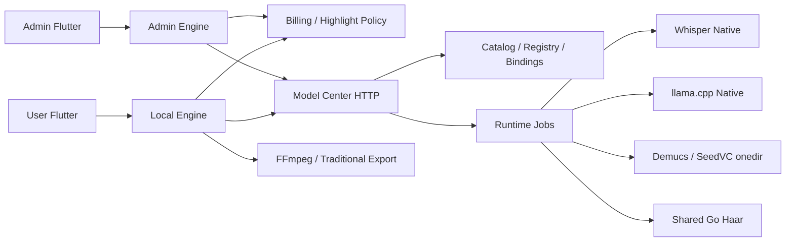
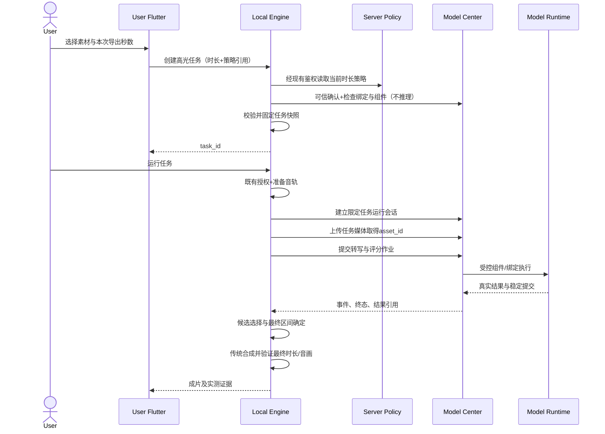

# Design Document

## Overview

将中心从资产盘点扩展为受控本地模型执行宿主，用户版经本地引擎调用中心，不直接访问 llama 服务、Python 脚本或 Whisper 可执行文件。既有只读发现与报告不变；新增运行授权、场景绑定、任务媒体上传、异步执行及 typed 结果。FFmpeg 音轨准备、候选编排、传统第二阶段合成与业务授权仍归引擎，中心不变成任意文件或命令网关。

高光导出时长另建服务器版本化策略文档，不修改历史 HighlightConfig 的 canonical wire。服务器首次显式创建策略采用 min=20、default=60、max=120，整数秒，上限600秒。用户选择每条成片时长，创建时校验并冻结，直到最终 FFprobe 验证都以该值为准。

本文件描述待实现设计；现有十二项资产存在、report 可读或已有本机 llama-server 均不是运行交付证据。旧 local-model-center 规格中仍未完成的文件系统、打包与实窗验证不会因本规格建立而自动完成。

### 已核实基线

| 位置 | 当前事实 | 本轮处理 |
|---|---|---|
| src/model_center/dashboard_snapshot.go | 中心提供十二项存在三态报告，GET不扫描 | 保留资产报告，额外提供独立运行证据 |
| src/model_center/integration | Windows命名管道身份确认及只读会话 | 新增独立运行会话，不扩权现有只读token |
| src/user_client/backend/cmd/fengshen-engine/task.go | 新建本地自定义路由被 inventory-only 门禁拒绝 | 只为新 center 路由建立完整前置门禁 |
| user/developer highlight_task.go | 转写直接启动Whisper，loopback评分直连HTTP | 新快照选择中心适配器；旧快照原分支不改 |
| installer/build_model_center.ps1 | whisper-stream明确pending_build；缺原生协议入口 | 补真实原生实现和构建，不以batch替换stream |
| src/model_center/components/manifest.go | 无llama文本/视觉执行组件 | 加受控llama运行组件及协议证据 |
| sidecar/model_center_frozen_runner.py | 有冻结入口，但权重来源仍依赖默认行为 | 显式按绑定解析本地权重与配套资源、禁止下载 |
| user internal/timbre/separate.go | Demucs/Seed-VC通过旧sidecar脚本 | 新任务注入中心适配器，保留音频结果契约 |
| generation_server/internal/images | Go Haar检测、XML嵌入，服务器自有预检 | 最小提取可共享Go检测包，中心本地预检不替代服务器验证 |
| billing core/highlight_config.go | candidate时长20/60/120及旧JSON哈希约束 | 另建最终导出策略，保持旧序列化字节 |
| admin ModelsPage | 云场景和高光评分配置，无本机场景binding | 在既有区域增中心场景绑定，标明本机作用域 |

## Architecture





### 模块边界

- `src/model_center` 保持独立 Go module；增加 bindings、runtimejobs、runtimeadapter 等按职责的小包，不将全套模型依赖拉进 integration 轻量包。
- `integration` 增加运行协议 DTO 与可信客户端；三端使用同一契约。管理绑定需要管理权限，运行需要任务权限，现有 Inspect/Report/Dependencies 仍被动只读。
- `generation_server/highlight` 共享管线仅依赖转写/评分等接口，不导入用户引擎或中心 main；具体中心 adapter 放引擎适配层或可复用轻量integration客户端层。
- 共用原生入口、锁定输入放仓库共享 resources 区域，构建脚本放 installer 根，产物及大测试证据放仓外；最终源文件名在实现时遵循已有目录，不生成占位交付。
- Haar 从当前 internal/images 最小抽取到 generation module 的公开小包，原服务器内部包装调用它，保留XML字节、错误映射与服务器验证位置，避免中心越过Go internal导入边界或拷贝漂移两套算法。

## Components and Interfaces

### 1. Binding Store and Capability Resolution

资产登记只说明允许盘点的位置，不自动授权反序列化。新增独立 binding 文档，由本机管理者明确选择能力和文件组成；首次打开不自动将十二项found全部设为可运行。

固定场景：

| 场景 | 模型资产 | 执行组件 | 输出 |
|---|---|---|---|
| highlight.transcribe | whisper-asr、可选whisper-vad | whisper-batch或whisper-stream（明确区分） | 时间戳/置信度/稳定提交 |
| highlight.score | local-text分片组 | llama-runtime | 现有评分结构 |
| highlight.vision | local-vision+projector | llama-runtime | 现有视觉结构 |
| timbre.separate | demucs或demucs-ft完整组 | demucs-runner | vocals/accompaniment WAV |
| timbre.convert | seed-vc+seed-whisper+campplus+bigvgan | seedvc-runner | 转换WAV |
| image.face | haar-frontal+haar-profile | Go Haar | frontal/profile/no_face |

绑定请求只引用当前inventory ID、opaque文件/组ID、组件ID/版本与受限选项；中心自行解析受限路径并检查身份。持久化使用已有登记数据目录的生命周期排他锁及事务提交语义，独立schema/revision，不能复用“配置损坏视为空”的逻辑。绑定更新不改模型文件，不回写用户历史配置。

执行时冻结 ExecutionBindingRef（revision + SHA256）及模型文件身份、大小、mtime、组件manifest摘要。新任务可显式重新选择后生成新快照，旧任务不随绑定变更自动切换；已接纳作业固定身份，后续重开发现变化立即失败。权重的 pickle/原生加载在已明确授权的子进程发生，中心安全范围不是恶意模型的操作系统沙箱，不声称可安全加载任意不可信权重。

能力响应区分 `missing_binding / missing_component / incompatible / available / busy / failed`，`available` 仅说明可尝试执行。真实推理证据包含能力、输入摘要、组件/绑定身份、开始/结束、结果；没有真实请求不得写 passed。

### 2. Runtime Admission and Process Supervisor

Whisper：实现原生 `--fengshen-stream-v1` 入口，使用锁定whisper.cpp库，按已有NDJSON协议处理有界PCM块、结束消息、时间戳和稳定提交。解码上下文在一作业中保持，不能每块重新调用batch并贴上stream标签；采用背压、单调序号、取消检查、输入格式/采样数校验及进程异常处理。batch能力保留独立接口与证据。

llama：新增 `llama-runtime` 组件清单，文本和视觉可共享受控版本但独立绑定。中心用直接进程API、固定参数模板、独立回环端口和每次启动内部随机认证启动子服务；不接收HTTP客户端指定服务URL，不默认接管现存11434端口。连接不走代理、不重定向。加载失败、未知架构、projector不兼容和OOM按能力返回，不自动下载、不切换模型。模型输出视为数据，严格映射现有评分/视觉类型，不执行其中的命令或把文本当路径。

冻结组件：Demucs支持本地repository/bag配置和选择的完整权重组；Seed-VC显式传入本地checkpoint、配置和三项依赖位置，禁用默认联网获取，BigVGAN保持无首启编译分支。冻结入口只支持固定子命令，元数据入口不import模型，模型路径只由中心内部绑定注入，不向HTTP开放任意模块/参数。

进程管理：持有实际进程对象、PID、创建时间、映像身份、组件与绑定；Windows对中心创建的模型子树使用独立kill-on-close Job或同等验证机制，中心本身不放进客户端kill-on-close Job。每次停止仅针对匹配的所属子树。现存外部服务默认不接管，不允许任意端口服务成为可信复用对象。相同中心所属组件/绑定可复用，空闲5分钟卸载；首版模型重计算活动槽为1，排队上限8，避免文本/视觉/音色全模型并载。纯Go Haar另设最多2个短请求槽，不改变扫描/摘要控制器的既有限制。

### 3. Trusted Runtime Sessions

扩展命名管道的显式会话申请：通过同用户SID、实际对端进程映像/创建时间、受信引擎交付摘要确认客户端。不能只相信请求JSON自报edition、PID或“已授权=true”。既有设备/功能授权继续由引擎验证，管道身份确认不传递服务器秘密给中心，也不声称抵御同用户恶意代码。

运行会话绑定中心instance、引擎进程身份、task_id、能力allowlist和固定binding refs。token仅内存，5分钟租期，通过已认证心跳延长（最长单会话2小时；更长任务重新握手并保持task/job引用），32个会话上限；过期取消仍在运行的本会话作业。引擎挂掉不续期，中心作业有界退出。重新握手不能取得其他task资产。浏览器管理token和现有60秒只读token与运行token完全分离。

管理版引擎通过独立的可信管理会话代理binding写入；Dart不接触中心任何token。普通用户引擎运行会话不具备绑定写权限。

### 4. Runtime HTTP API

以下均为新增设计接口，沿用仅回环、安全头、Host/Origin/Fetch-Site、严格方法和JSON验证；只读/管理/运行按权限表精确分开。

| 权限 | 方法/路由 | 责任 |
|---|---|---|
| 只读 | GET /api/integration/runtime-capabilities | 已有绑定及运行证据投影；不启动组件 |
| 管理 | GET /api/bindings | binding文档与revision |
| 管理 | PUT /api/bindings/{scene} | expected_revision+inventory/file/group引用 |
| 管理 | DELETE /api/bindings/{scene} | 仅取消绑定，不改权重 |
| 运行 | POST /api/runtime/assets | 流式上传一项任务媒体，返回asset_id |
| 运行 | POST /api/runtime/jobs | binding_ref+asset_ids+固定能力参数+request_id |
| 运行 | GET /api/runtime/jobs/{id} | 同任务进度、终态、结果引用 |
| 运行 | GET /api/runtime/jobs/{id}/events | 有序SSE与可恢复游标；stream稳定提交 |
| 运行 | POST /api/runtime/jobs/{id}/cancel | 幂等取消 |
| 运行 | GET /api/runtime/jobs/{id}/results/{result_id} | 有界JSON或中心生成的任务WAV；不是任意文件下载 |
| 运行 | DELETE /api/runtime/sessions/current | 结束本会话，回收所属工作 |

轻量JSON上限64KiB，评分/转写JSON结果最多4MiB（更大按有序结果分页），评分输入沿用现有候选字段上限。媒体上传按类型区分：PCM WAV每项最多1GiB、图像8MiB且解码最大4096×4096，总活动spool上限4GiB、每会话32项；以Content-Length与实际字节数双重校验，逐块写入独占临时文件并在完整格式检查后才发布asset ID。上传不能以压缩包或任意二进制“自动识别执行”。文件名不参与路径构造。

WAV结果须在中心临时根内新建、拒绝symlink/reparse、校验格式/大小/时长后发布，下载只按结果ID。引擎下载到自己的新建任务工作文件并检查摘要、长度与音频性质；不信任组件stdout中的路径。返回媒体是本任务生成的输出，不开放模型、源盘路径或范围浏览。

### 5. Job Lifecycle and Resource Limits

状态为 `queued → loading → running → succeeded/failed/cancelled`。独立task context不受启动HTTP请求结束影响。request_id绑定任务与请求body摘要；重复相同请求返回同job，冲突body返回409；网络异常先查询，不盲重发。

首版默认模型作业最长30分钟，Haar10秒，队列等待2分钟；续传/事件连接不重置作业deadline。暂停/取消的剩余输入不继续执行，取消状态不能发布成功。一个episode超1GiB音频时由引擎按既有时间轴分块并带偏移，中心不截断上传冒充完整转写。

SSE游标单调，事件环最多2048条；落后游标410要求读当前结果，不补造丢失稳定提交。作业终态保留30分钟/最多128条，当前被引擎确认未接收的结果按spool容量约束保留，满额明确拒绝而不删活跃结果。中心关闭时拒绝新任务、取消作业、停止自身子树、关闭句柄；仅清理本次创建的临时目录，不清理权重缓存。

### 6. Export Duration Policy Service

最终时长使用独立文档 `highlight_export_policy`，不加进旧HighlightConfig canonical字节，也不改现有video generation的duration_seconds。

管理API：GET/PUT `/admin/params/highlight-export`，PUT携带base_version；历史GET采用同一参数版本服务的独立命名空间，不通过Scan寻找历史。提供本地引擎授权用户读取的策略resolve端点，由既有Billing/Generation鉴权路径承载，语义是读取公开时长政策，无需调用云评分或解析Provider secret。若现有resolve强制秘密引用，在相同鉴权体系新增独立policy resolve，不伪造secret_revision。

新文档首次必须显式写入，代码默认20/120/60仅用于管理端“创建新策略”草稿，不能在读取缺失时假装服务器已发布。策略ref：kind=`highlight_export`、version、SHA256（仅策略canonical JSON），任务创建在现有授权链取当前策略，比较前端ref，事务写快照。版本变化返回409，不自动clamp或静默重发；已接纳任务冻结旧策略可继续，不因后续管理员改范围而改已有任务。

### 7. User Task Route and Snapshot

新增 `model_execution=center` 和匹配 `score_route=center`，不重解释旧local/loopback字段。中心任务快照显式schema2，包含analysis链、绑定引用和export policy。旧snapshot解码/旧local路径/云ref按旧分支处理，不批量补写字段。跨端域校验同时更新，旧格式canonical测试保持逐字节通过。

用户创建DTO新增 `export_duration_sec` 与 `export_policy_ref`；未填时长采用当前策略default。未填policy ref的旧客户端不得创建新schema2中心任务；旧云路由按已声明协议处理，不凭缺字段自动升级。服务端校验发生在MarshalTaskSnapshot/CreateTask/任务workdir创建之前。新复制任务重新走当前策略与能力门禁，不信任外部ParamsJSON。

创建前检查中心身份、绑定和组件元数据，不加载模型；显式运行才建立任务会话并加载。能力结构分别给出custom_url_model_configurable=false、center route支持及逐能力状态，不用一个永久true代表所有功能已验证。必要能力缺失返回稳定错误；旧自定义URL依然被拒绝，受支持云路径不受影响。

### 8. Final Duration Planner and Traditional Export

candidate窗口保持分析语义。新增共享DurationPlanner，在真实高光事件确认后，以目标整数秒和同集素材时间轴确定可行区间：优先保留完整话语/事件，按合法上下文扩展或从冗余lead/trail调整；调整后必须重新检查完整性和评分适用性，超原评分覆盖范围则重新评分。若无法同时满足目标与完整性，跳过该候选继续分析，不强切对话或人为降阈值。

导出区间按输出帧率使用整数frame/timebase计算，目标时长不可被传统Reserve/随机TargetDuration、tempo、转场重叠和尾片段覆盖。高光schema2的第二阶段接收固定目标约束；通过对既有prepare/compose的最小定点修改，使非高光参数随机机制不变。音频采用既有独立-ss/-t、asetpts/采样率/时间基定式，保持语义速度，不靠变速或填充补时长。

实际duration容差为一个视频帧加一个音频编码帧（AAC以1024/sample_rate计算）；报告video、audio、container各自测值，音画时长差仍须小于0.1秒，不以容差替代同步检查。最终输出失败不MarkDone，不Record成功manifest；失败产物只处理本任务新建文件，不碰已有成片。

### 9. Other Model Adapters and UI

音色流水线注入 `Separate/Convert` 接口，中心路由实现先上传source/reference、提交typed作业、取WAV并验证。旧任务使用原sidecar adapter，新的中心任务不回落host Python；原DSP降级策略对未启用AI功能继续有效，用户明确启用但中心失败不能假报AI处理成功。冻结输入显式指向完整权重，子组件不是用户单独的操作按钮。

Haar本机预检从用户引擎调用中心；服务器最终人脸校验保持原位置和规则。中心断连不得把本地预检当服务器授权已通过；结果显示两层不同责任。

管理版在现有模型场景区增加绑定与运行证据，数据来自中心报告/绑定API，明确“本机”。高光处理区增加独立min/max/default草稿与版本保存；用户版向导只放本次时长与只读范围，不重新引入模型配置卡。开发版同步共享DTO/路由/时长契约，管理版不创建用户推理任务。现有依赖逐行并发检查仅查询元数据/已有证据，保持可选降级和结束事件。

## Data Models

```go
type ExportDurationSeconds struct {
    Min int `json:"min"`
    Max int `json:"max"`
    Default int `json:"default"`
}
type ExportPolicy struct {
    Schema int `json:"schema"`
    ExportDurationSeconds ExportDurationSeconds `json:"export_duration_seconds"`
}
type ExportPolicyRef struct {
    Kind string `json:"kind"`
    Version int64 `json:"version"`
    SHA256 string `json:"sha256"`
}
type FrozenExport struct {
    DurationSec int `json:"duration_sec"`
    Policy ExportPolicy `json:"policy"`
    PolicyRef ExportPolicyRef `json:"policy_ref"`
}
type ExecutionBindingRef struct {
    Scene string `json:"scene"`
    Revision uint64 `json:"revision"`
    SHA256 string `json:"sha256"`
}
type RuntimeJobRequest struct {
    RequestID string `json:"request_id"`
    Binding ExecutionBindingRef `json:"binding"`
    AssetIDs []string `json:"asset_ids"`
    Parameters json.RawMessage `json:"parameters"`
}
```

Parameters按能力解成固定DTO、DisallowUnknownFields，不把RawMessage透传进子进程。绑定持久化内部保存受限文件位置及身份，但HTTP执行快照只发opaque引用。尺寸字节继续用十进制字符串，API不使用JS不安全大整数。请求/响应中的路径和错误均按文本渲染。

新任务FrozenCenterExecution包含schema2、分析/媒体参数、binding refs、组件协议与FrozenExport；不包含会话token、URL、秘密或CLI路径。实际作业结果附typed provenance，媒体结果为result ID、bytes、SHA256、sample rate/channels/duration，不是任意路径。

## Error Handling

| 稳定码 | 情况 | 用户行为 |
|---|---|---|
| center_identity_unconfirmed | 中心/引擎身份或构建不符 | 显式重新确认，不连接未知端口 |
| center_binding_missing / center_binding_stale | 未选择或身份变化 | 管理版重新绑定，新建新任务 |
| center_component_missing / center_protocol_unsupported | 缺交付/流式协议 | 指明组件，不伪装batch通过 |
| center_model_incompatible | 权重格式或projector不兼容 | 保留资产信息，修正绑定 |
| center_runtime_busy / center_spool_full | 队列或容量达限 | 明确可重试，不清理用户缓存 |
| center_session_expired / center_asset_forbidden | 租期/归属错误 | 重新可信握手，仅恢复本任务 |
| center_job_timeout / center_job_cancelled | 超时/取消 | 保留终态，清所属临时资产 |
| center_result_invalid | 非法模型结果/WAV | 失败，不能计成功 |
| highlight_export_policy_missing | 服务器未配置/不可用 | 不创建新任务，管理员显式保存 |
| highlight_export_policy_changed | 前端ref过期 | 409，更新范围保留输入，不自动提交 |
| highlight_export_duration_invalid | 非整数/越界/NaN类型 | 422，无任务副作用 |
| highlight_export_unachievable | 无完整候选满足目标 | 继续候选或耗尽，不造假出片 |
| highlight_output_duration_invalid | 实测时长/音画不符 | 不计完成，保留明确失败证据 |

原有授权失败码保持，不把其改成可忽略降级。底层完整路径、stdout、素材文本不直接放到网络错误和普通日志。写请求不因网络不确定自动重放；可查询request_id确定是否已接纳。

## Testing Strategy

1. 契约与绑定：固定六类场景、十二项模型关系，覆盖多分片/projector、Demucs FT/Seed套件组、revision冲突、损坏store、登记与文件变更、受限路径；原report tri-state及GET不扫描保持。
2. 权限与安全：管理/只读/运行token交叉拒绝、真实管道对端身份、未知引擎、跨task资产/结果、路径字段拒绝、upload超额/伪格式/解码炸弹、Host/Origin、无代理/redirect、日志无token。
3. 状态与进程：可控时钟/子进程覆盖排队、deadline、幂等、未知请求结果、SSE丢游标、取消/终态发布竞态、客户端死亡、中心关闭；不杀复用中心或外部llama进程。
4. 二进制：锁定输入构建、真正原生stream连续上下文/NDJSON/长音频有界内存，llama文本+视觉，冻结Demucs/Seed；metadata smoke、干净Windows环境与真实推理分别记录。没有原生实现或真实产物时保持未完成，不能删除原先pending断言强行绿。
5. 时长：服务器策略保存/读投影/独立hash/历史版本，1/600端点与错误值；创建默认/用户覆盖/冲突零副作用、续跑/复制语义，旧canonical与快照goldens逐字节不变。
6. 媒体：共享planner覆盖源不足、事件过长、边缘上下文、可变帧率及有转场/tempo配置；真实FFmpeg/FFprobe覆盖20/60/120秒及不同用户合法值，断言后阶段不随机重选目标、A/V时长差<0.1秒和请求误差容差。
7. 三端：用户向导范围/输入/错误与进度，管理保存/绑定/只读作用域，开发共享DTO；Dart widget+analyze后仍必须通过允许的真实GUI热重载捕获正常/错误画面。没有运行中的目标不擅自重启，保持验收阻断。
8. 真实交付验收：独立脚本启动隔离后端与明确构建身份，运行用户引擎创建的target=1任务；自然集序、原素材只读，默认60秒，输出唯一新目录。保存完整provenance、模型作业和成片probe/hash，再播放核验；不把随机截取或合成fixture当指定素材高光。

### 需求到验证的映射

- R1–R3：bindings/catalog/组件构建及逐能力真实调用。
- R4–R5：IPC/HTTP安全、上传限额、状态机与真实进程所有权。
- R6–R7：用户引擎管线、原生stream、音色/Haar功能回归及旧快照不变。
- R8–R10：服务器策略、三端DTO、创建/恢复与真实媒体长度检查。
- R11–R12：真实界面、被动依赖/报告、指定目录的一条可播放成片及证据审计。
